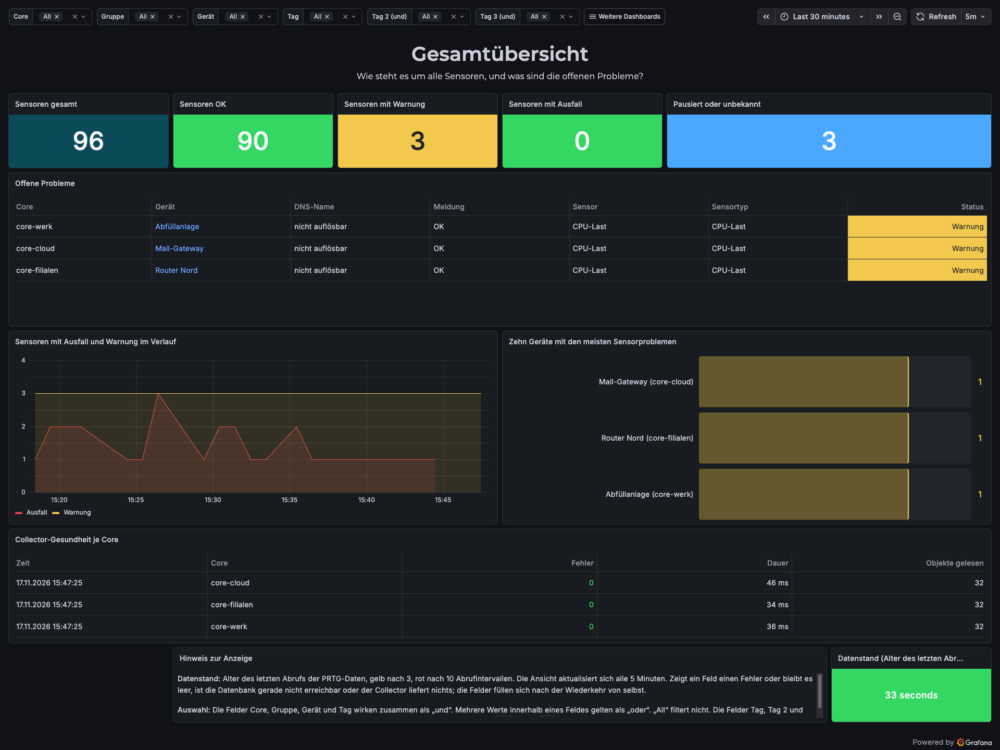
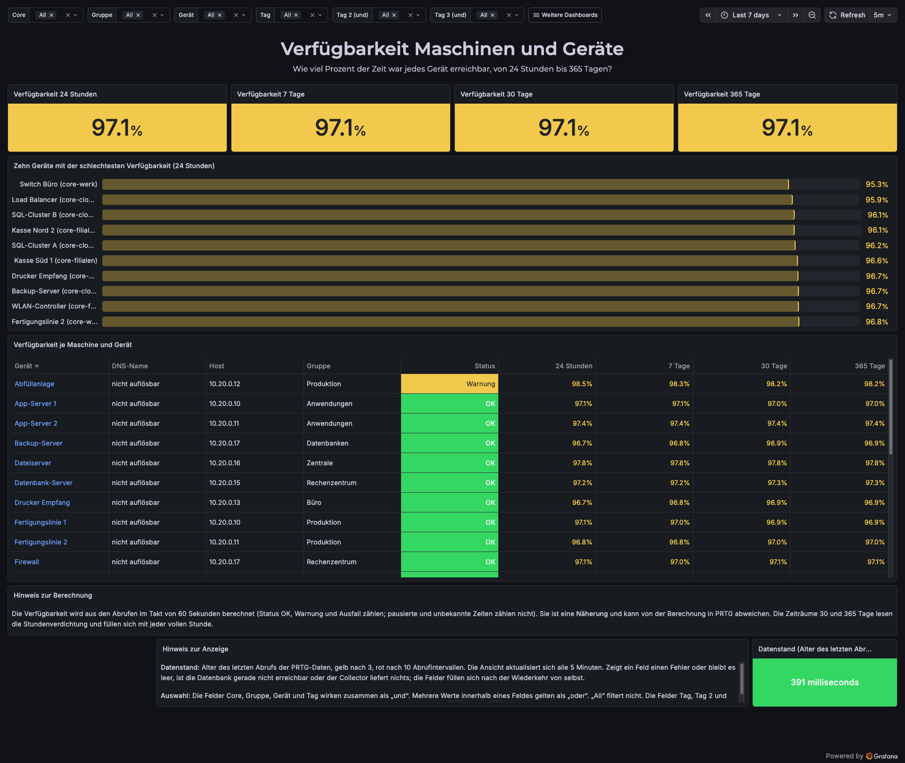

  <picture>
    <source media="(prefers-color-scheme: dark)" srcset="docs/assets/netmon24-logo-white.svg">
    
  </picture>

# PRTG-Grafana

Ihre PRTG-Daten, frei auswertbar: Dieses Paket von netmon24 holt Messwerte und Zustände aus einem oder mehreren PRTG-Servern, speichert sie ein Jahr lang und zeigt sie in fertigen Grafana-Dashboards. Kunden und Kollegen können daraus eigene Ansichten bauen, ohne etwas zu programmieren.

PRTG wird dabei **nur gelesen**. Es wird nichts in PRTG angelegt, geändert oder pausiert.

Aktuelle Version: 0.3.4. Läuft mit Docker, die fertigen Images gibt es kostenlos in der GitHub-Registry.

## Was Sie bekommen

- **13 fertige Dashboards**, zum Beispiel Gesamtübersicht, Verfügbarkeit je Gerät, Sensor- und Kanalverlauf, Festplatten, Zertifikate, Webseiten.
- **Eigene Ansichten über PRTG-Tags:** Ein Tag in PRTG vergeben, in Grafana auswählen, als eigenes Dashboard speichern. Mehrere Tags lassen sich mit „oder“ und „und“ verbinden.
- **Mehrere Kunden getrennt:** Jeder Kunde hat seine eigene Grafana-Organisation und seine eigene Datenablage. Ein Kunde sieht nur seine Daten.
- **Ein Verwaltungsportal im Browser:** Kunden und PRTG-Server eintragen, Verbindung testen, Zertifikate bestätigen, Zeiten und Filter einstellen. Dateien bearbeiten müssen Sie dafür nicht.
- **Verschlüsselung** für Grafana, Datenbank und Portal, wahlweise mit eigenem Zertifikat oder Let's Encrypt.

## So fangen Sie an

Auf einem Server mit Docker oder Portainer: Schritt für Schritt in der Anleitung **[docs/ausrollen.md](docs/ausrollen.md)**. Die Kurzfassung für einen Rechner:

1. Die Datei `.env.example` nach `.env` kopieren und die Pflichtwerte eintragen. Für Passwörter und Schlüssel eignet sich `openssl rand -hex 24`.
2. `docker compose up -d` starten. Das lädt die Images aus `ghcr.io/netmon24/prtg-grafana`.
3. Das Portal im Browser öffnen (`http://localhost:8088`) und mit dem Benutzer und Passwort aus der `.env` anmelden.
4. Einen **Kunden** und dazu einen **PRTG-Server** eintragen: Adresse (`https://<server>:1616`), API-Key und Zertifikat. Mit **Verbindung testen** prüfen.
5. Grafana öffnen (`http://localhost:3000`, Benutzer `admin`) und die Organisation des Kunden wählen. Nach etwa zwei Minuten sind die Dashboards gefüllt.

Alles Weitere, also Datenbank, Zugangsschlüssel, Grafana-Organisation und Dashboards, richtet das Portal beim Speichern selbst ein.

## Was Sie einstellen können

| Einstellung | Wo | Standard |
|---|---|---|
| Port von Grafana und wer darauf zugreifen darf | `.env`: `GRAFANA_PORT`, `GRAFANA_BIND` | 3000, im Netz |
| Ob die Datenbank von außen erreichbar ist | `.env`: `INFLUX_BIND` (`127.0.0.1` = nur intern, `0.0.0.0` = offen) | nur intern |
| Passwörter und Zugangsschlüssel | `.env` | Pflicht |
| Wie lange Daten aufbewahrt werden | `.env`: `INFLUX_RETENTION_DAYS` | 365 Tage |
| Port des Portals und wer darauf zugreifen darf | `.env`: `PORTAL_PORT`, `PORTAL_BIND` | 8088, nur intern |
| PRTG-Server, API-Keys, Zertifikate, Abruftakt, Filter | **Portal** | alle 60 Sekunden |
| Verschlüsselung für Grafana, Datenbank und Portal | **Portal**, Seite Zertifikate | aus |

Der Wert `PORTAL_SECRET_KEY` schützt die im Portal gespeicherten API-Keys. Notieren Sie ihn sicher und ändern Sie ihn nach dem ersten Einsatz nicht mehr, sonst sind die Keys nicht mehr lesbar.

## Die Dashboards

*Gesamtübersicht mit drei Demo-Cores. Alle Namen und Werte sind erfunden.*

*Verfügbarkeit je Gerät, ebenfalls mit Demodaten.*

1. **Gesamtübersicht:** Wie steht es um alle Sensoren, was sind die offenen Probleme.
2. **Verfügbarkeit:** Je Gerät Status und Verfügbarkeit in Prozent für 24 Stunden, 7, 30 und 365 Tage.
3. **Tag-Ansicht:** Die Vorlage für eigene Ansichten. Anleitung: [docs/tag-anleitung.md](docs/tag-anleitung.md).
4. **Sensor- und Kanalverlauf:** Der Verlauf eines Messwerts, mit Vergleich zu gestern und zur Vorwoche.
5. **Meldungen und Ereignisse:** Wann hat welcher Sensor seinen Status gewechselt.
6. **Probe- und Core-Health:** Wie geht es der PRTG-Probe und dem PRTG-Server selbst.
7. **Sensorstatus:** Alle Sensoren auf einen Blick, mit Tabelle.
8. **Gruppenstatus:** Eine Kachel je Gruppe.
9. **Festplatten und Speicherplatz:** Belegt und frei je Laufwerk.
10. **DNS und Active Directory:** Status und Antwortzeiten.
11. **Zertifikate:** Wie lange sind sie noch gültig.
12. **Webseiten:** Status, Antwortcode und Ladezeit.
13. **Gerätestatus:** Eine Filtervorlage für eigene Ansichten.

Die Grenzwerte für gelb und rot in den Dashboards 6 bis 13 sind Vorschläge. Im jeweiligen Dashboard steht, welche Werte gelten. Sie lassen sich in einer eigenen Kopie ändern.

Zwei Dinge sollten Sie wissen:

- Die **Verfügbarkeit** wird aus den Abrufen berechnet, die jede Minute stattfinden. Sie kann deshalb von der Zahl abweichen, die PRTG selbst anzeigt. Ein kurzer Ausfall zwischen zwei Abrufen bleibt unsichtbar.
- Die **Ereignisse** in Dashboard 5 sind aus den Statuswechseln abgeleitet. PRTG stellt über diese Schnittstelle keine Meldungstexte bereit.

## Wenn etwas nicht läuft

- Das Betreiber-Handbuch erklärt Fehlersuche, Sicherung und Verschlüsselung: [docs/betreiber-handbuch.md](docs/betreiber-handbuch.md).
- **Ein PRTG-Server liefert keine Daten und meldet Fehler 503?** Prüfen Sie zuerst die **Lizenz des PRTG-Servers**. Ist sie abgelaufen oder inaktiv, sperrt PRTG die ganze Schnittstelle, auch mit gültigem API-Key. Das Portal zeigt dann „Die PRTG-Lizenz ist inaktiv“. Nach dem Erneuern der Lizenz holt der Abruf von selbst wieder Daten.
- Zum Ausprobieren ohne PRTG liegt ein Demo-Server bei: `cd collector && uv run python ../scripts/demo_stub.py`. Im Portal tragen Sie dann `http://host.docker.internal:<Port>` ein und stellen das Zertifikat auf „nicht prüfen“.
- Die Tests starten Sie mit `cd collector && uv run pytest`.

## Sicherheit

- PRTG wird ausschließlich gelesen.
- API-Keys liegen verschlüsselt im Portal und erscheinen weder in der Oberfläche noch in den Protokollen.
- Das Portal hat keinen Zugriff auf Docker.
- Nicht ins Git gehören `.env` und `cores.yaml`. Beide enthalten Ihre Zugangsdaten.
- Sicherheitslücken melden Sie bitte nicht öffentlich, sondern wie in [SECURITY.md](SECURITY.md) beschrieben.

## Lizenz und Marken

Apache License 2.0, siehe [LICENSE](LICENSE) und [NOTICE](NOTICE). Copyright 2026 netmon24 GmbH & Co. KG.

PRTG und Paessler sind Marken der Paessler GmbH und werden hier nur zur Beschreibung genannt. Dieses Projekt steht in keiner Verbindung zu Paessler. Grafana und InfluxDB sind Marken ihrer jeweiligen Inhaber.
